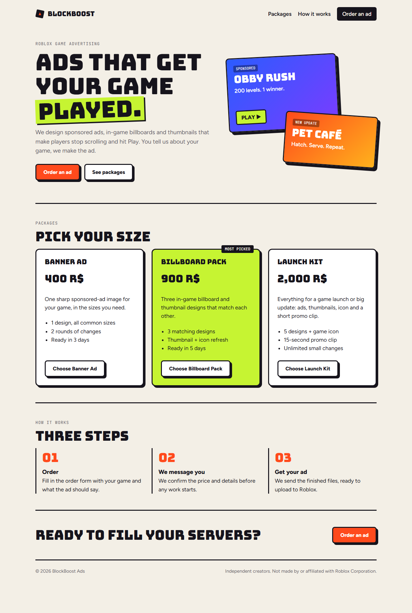
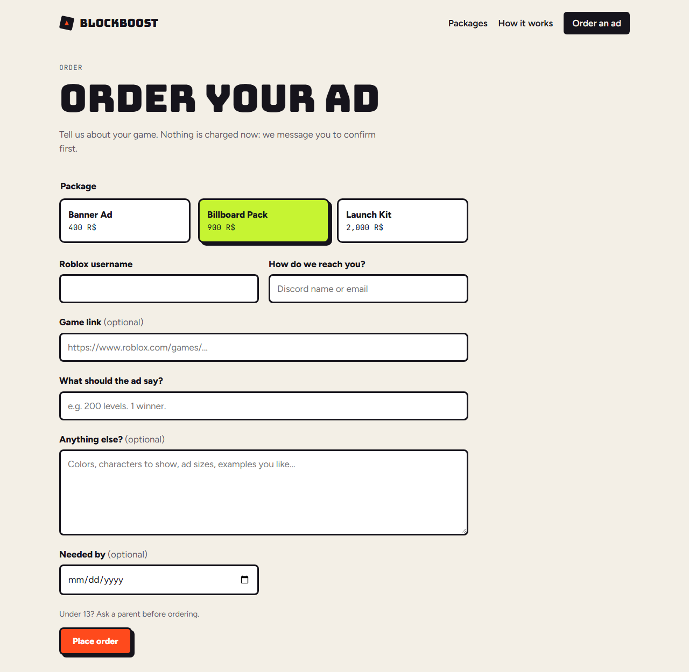
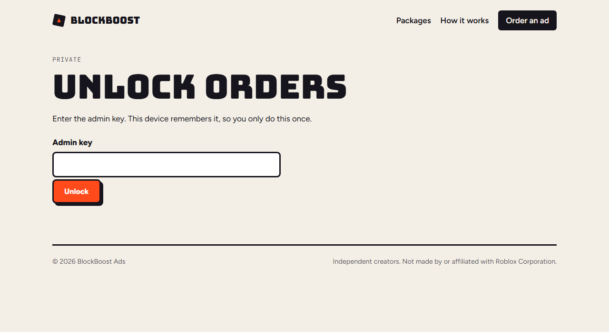

# BlockBoost Ads

An ordering site for a Roblox game-advertising service. Customers browse ad packages,
place an order, and get an order number. The owner manages orders on a private,
key-protected page.

**Live site:** https://blockboost-ads.jbmcnichols3.workers.dev

**Stack:** Next.js 16 (App Router) · React 19 · Cloudflare Workers via OpenNext · Cloudflare D1 (SQLite)

## Screenshots

| Landing page | Order form | Admin (locked) |
|---|---|---|
|  |  |  |

## Pages

| Route | What it does |
|---|---|
| `/` | Landing page: packages, pricing, how it works |
| `/order` | Order form (`/order?package=launch` preselects a package) |
| `/admin` | Private order dashboard: filter by status, update, delete |

## How it works

- **Public write, private read.** `POST /api/orders` is open to everyone; there is no public
  read endpoint. Everything under `/api/admin/*` requires `Authorization: Bearer <ADMIN_TOKEN>`,
  checked with a constant-time comparison (`lib/admin.js`).
- **Safe SQL.** All queries use bound `?` parameters (`lib/db.js`), so user input is never
  executed as SQL.
- **Input validation.** Fields are trimmed and length-capped on the server; the package must
  match a known id.
- **Spam filter.** A hidden honeypot field silently drops bot submissions.
- **One source of truth.** Packages and prices live in one list (`PACKAGES` in `lib/db.js`)
  used by both the landing page and the order form.
- **Schema as migrations.** The table is defined in `web/migrations/`, applied with Wrangler.

```
web/
  app/              pages and API routes
  components/       OrderForm (client), AdminOrders (client)
  lib/db.js         D1 query helper + packages list
  lib/admin.js      admin-key check
  migrations/       D1 schema
orders.py           command-line order viewer (uses the admin API)
```

## Run it locally

```bash
cd web
npm install
echo "ADMIN_TOKEN=pick-a-long-random-key" > .dev.vars
npm run db:local      # create the local D1 table
npm run dev           # http://localhost:3000
npm run preview       # optional: run the real Cloudflare Worker build locally
```

## Deploy

```bash
npx wrangler d1 create blockboost-orders   # put the printed id in wrangler.jsonc
npm run db:remote
npx wrangler secret put ADMIN_TOKEN
npm run deploy
```
